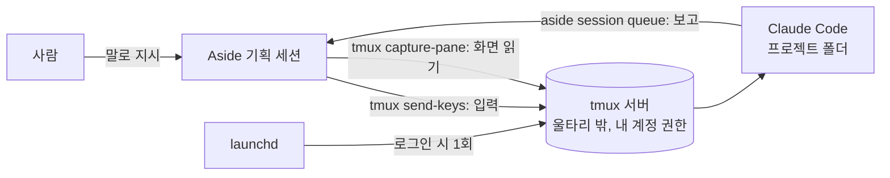

## 0. 이 문서를 쓰는 법

이 문서의 각 단계는 이렇게 생겼다.

> **🗣 Aside에게**
>
> Aside에게 그대로 복사해 보내는 문장

- **Aside가 하는 일:** 그 문장을 받으면 Aside가 실제로 하는 일
- **사람이 할 일:** 있을 때만 적는다
- **됐는지 보는 법:** Aside 답에서 확인할 것

### 0.1 사람이 직접 해야 하는 것은 이것뿐이다

| # | 사람이 할 일 | 왜 Aside가 못 하나 | 언제 |
|---|---|---|---|
| 1 | Aside 앱 설치·로그인 | Aside가 아직 없다 | 맨 처음 1회 |
| 2 | 터미널에 **한 줄** 붙여넣기 + 맥 비밀번호 입력 | 아래 0.2 | 맨 처음 1회 |
| 3 | Aside 설정 화면에서 허용 폴더 1개 추가 | 보안 설정은 사람이 화면에서 바꾸는 게 원칙 | 맨 처음 1회 |
| 4 | 브라우저에서 Claude 로그인 승인 | 로그인·비밀번호는 사람이 한다 | 맨 처음 1회 |
| 5 | macOS 「접근 허용」 창에서 허용 클릭 | 운영체제 보안 창은 사람만 누를 수 있다 | 폴더마다 처음 1회 |
| 6 | 무엇을 만들지 결정, 결과 판단 | 기획의 주인은 사람 | 매번 |

그 밖의 설치, 설정 파일 작성, 자동 실행 등록, Claude Code 기동, 지시, 결과 확인은 **모두 Aside에게 말로 시킨다.**

### 0.2 왜 처음 한 줄만은 사람이 쳐야 하나

- Aside 에이전트가 쓰는 셸은 **샌드박스(울타리) 안**에서 돈다. 홈 폴더가 가짜(`~/.aside/runtime/home`)이고 `~/Library` 같은 곳에 쓰지 못한다. 그래서 Aside가 혼자서는 프로그램 설치, `~/Library/LaunchAgents` 파일 작성, Claude Code 로그인 정보 사용을 못 한다(실측).
- Aside가 직접 tmux 서버를 띄워도 그 서버는 울타리 안이라 소용없었다(실측).
- 반대로 **사람이 터미널에서 띄운 tmux 서버**는 울타리 밖, 내 계정 권한으로 돈다. Aside가 그 서버에 붙으면 그 안의 셸로 무엇이든 할 수 있다(실측).
- 그래서 사람은 「울타리 밖 tmux 서버」를 **딱 한 번** 열어 주고, 그다음부터는 Aside가 그 서버를 통해 나머지를 전부 한다. 한 번 launchd 자동 실행을 걸어 두면 이후 로그인 때마다 서버가 저절로 뜨므로 이 한 줄도 다시 칠 일이 없다.

> **⚠️ 이 구조가 뜻하는 것**
>
> tmux 서버에 붙은 Aside는 **사실상 내 맥 계정의 셸 전체를 쓸 수 있다.** 「말로 다 시킬 수 있다」는 편리함과 같은 크기의 권한이다. 6장의 안전 규칙을 같이 읽는다. 통로를 닫고 싶으면 3.3에서 추가한 허용 폴더를 빼면 된다.

---

## 1. 큰 그림

| 이름 | 무엇인가 | 맡는 일 |
|---|---|---|
| Aside | AI 에이전트가 들어 있는 브라우저 앱 | 기획 세션. 조사·지시·검토, 그리고 이 문서의 설정 작업 |
| Aside CLI (`aside`) | 터미널에서 Aside를 부르는 명령 | Claude Code가 기획 세션에 보고하는 통로 |
| Claude Code (`claude`) | 터미널에서 도는 코딩 AI | 작업 담당. 코드 작성·테스트 |
| tmux | 터미널 화면을 「서버」에 맡겨 두는 프로그램 | Aside가 Claude Code에 입력하고 화면을 읽는 통로 |
| launchd | 맥의 자동 실행 장치 | 로그인할 때 tmux 서버를 자동으로 띄움 |



누가 언제 움직이나 (상시 감시 프로그램은 없다):

| 단계 | 시작하는 쪽 | 일어나는 일 | 시간 (실측) |
|---|---|---|---|
| 로그인 | launchd | tmux 서버를 띄우고 launchd 작업은 끝. 서버만 남는다 | 로그인 직후 1회 |
| Claude Code 기동 | Aside | 패널에 `cd <프로젝트> && claude` 입력 | 약 2초 |
| 지시 | 사람 → Aside → tmux | Claude Code가 일을 시작 | 짧은 답 약 3~5초 |
| 보고 | Claude Code | `aside session queue`로 기획 세션에 메시지 | 쉬는 세션 기준 수 초 |
| 잠자기·재부팅 | 맥 | 모두 멈춘다. 재부팅 후에는 다음 로그인 때 launchd부터 다시 | - |

---

## 2. 언제 이 방식을 쓰나

| 상황 | 추천 |
|---|---|
| 한자리에서 끝나는 작은 일 | 불필요. Claude Code만 쓰고 필요할 때 `aside exec`로 Aside를 부른다 |
| 기획 맥락이 길고(며칠 조사, 로그인된 사이트 확인), 작업은 같은 맥에서 | **이 문서의 방식** |
| 작업자가 다른 컴퓨터, 잠든 동안 알림 필요 | 범위 밖. GitHub 이슈 + Actions 구성 |

지시 하나가 양쪽에서 AI 사용량을 쓴다. 테스트 직후 Claude Code 화면의 누적 비용 표시는 첫 턴 $0.27, 몇 번 주고받은 뒤 $0.84였다(실측, Claude Max 화면 표시값).

---

## 3. 처음 설정 (한 번만)

### 3.1 Aside 앱 설치 (사람)

1. https://aside.com/download 에서 맥용을 받는다.
2. `Aside.dmg`를 열고 Aside를 「응용 프로그램」 폴더로 끈다.
3. Aside를 열고 로그인한다.
4. 프로젝트(예: `develop`)를 하나 만들고 그 안에서 새 대화를 연다. 이 대화를 **기획 세션**으로 쓴다. 아래 문장은 모두 이 세션에 보낸다.

### 3.2 설치 스크립트 만들기 → 사람이 한 줄 실행

> **🗣 Aside에게**
>
> 이 맥에 Aside × Claude Code 분담 개발 환경을 처음 설치하려고 해. 내가 터미널에서 한 번만 실행하면 되는 설치 스크립트를 이 프로젝트 폴더에 `bootstrap-mac.sh`로 만들어줘. 이미 깔린 건 건너뛰고, Homebrew → tmux → Claude Code → Aside CLI 순서로 설치하고, `~/.zprofile`에 Homebrew와 `~/.local/bin` PATH를 없을 때만 추가하고, 마지막에 `~/Develop`을 시작 폴더로 하는 tmux `dev` 세션을 분리 모드로 띄우게 해줘. 각 단계가 무엇을 하는지 스크립트 안에 주석으로 달고, 다 만들면 내가 터미널에 붙여넣을 한 줄을 알려줘.

- **Aside가 하는 일:** 프로젝트 폴더(예: `~/.aside/u/0/projects/develop/`)에 스크립트를 쓰고, 실행할 한 줄(예: `bash ~/.aside/u/0/projects/develop/bootstrap-mac.sh`)을 알려 준다. 스크립트 예시는 부록 A.
- **사람이 할 일:**
  1. `Cmd + Space` → 「터미널」 → Enter.
  2. Aside가 알려 준 한 줄을 붙여넣고 Enter.
  3. Homebrew 설치 중 「Press RETURN」이 나오면 Enter, 비밀번호를 물으면 **맥 로그인 비밀번호** 입력(화면에 안 보이는 게 정상). Homebrew가 Xcode 명령줄 도구도 함께 설치하므로 몇 분 걸릴 수 있다.
  4. 끝에 `dev: 1 windows ...`가 나오면 터미널 창은 닫아도 된다. tmux 서버는 계속 돈다.
- **됐는지 보는 법:** 마지막 출력에 `dev:` 줄이 있다. 오류가 나면 화면을 통째로 복사해 Aside에게 붙여넣고 `이 오류 원인 찾아서 스크립트 고쳐줘`.

### 3.3 Aside에 tmux 사용 허락 (사람, 설정 화면)

Aside 셸이 `/opt/homebrew/bin/tmux`를 실행하려면 허용 폴더에 넣어야 한다. 없으면 「Operation not permitted」가 난다(실측).

> **🗣 Aside에게 (안내만 받을 때)**
>
> tmux를 쓰려면 Settings에서 어떤 폴더를 허용해야 하는지, 메뉴 위치를 한 단계씩 알려줘.

- **사람이 할 일:** Aside **Settings** → **Agent** 그룹 → **Agents** → **File permissions** → **Can view** 옆 **Add** → 폴더 선택 창에서 `Cmd + Shift + G` → `/opt/homebrew` 입력 → 선택.
  - `/opt/homebrew/bin`이 아니라 `/opt/homebrew` 전체. tmux가 그 아래 라이브러리를 함께 불러오기 때문이다.
  - 같은 화면의 **Sandbox** 끄기 스위치는 건드리지 않는다. 모든 제한을 푸는 스위치다.

### 3.4 연결 확인

> **🗣 Aside에게**
>
> 로컬 tmux 서버에 붙어서 세션·패널 목록을 보여줘. 각 패널의 패널 ID, 실행 중인 명령, 보기 모드 여부, 현재 폴더까지. 붙은 서버가 샌드박스 밖에서 도는 서버인지도 확인해줘. 서버가 없으면 새로 띄우지 말고 알려줘.

- **Aside가 하는 일:** 소켓을 지정하지 않고 `/opt/homebrew/bin/tmux list-panes -a -F ...`를 실행한다. tmux는 사용자 번호로 기본 소켓(`/private/tmp/tmux-<사용자번호>/default`)을 스스로 찾는다. 이어서 그 서버의 환경 변수(`HOME`, `XPC_SERVICE_NAME`)로 어떤 서버인지 확인한다.
- **됐는지 보는 법:**
  - 패널 목록: `dev %0 zsh /Users/<나>/Develop`처럼 나온다.
  - 서버 확인: `HOME`이 진짜 홈(`/Users/<나>`)이고, launchd가 띄운 서버면 `XPC_SERVICE_NAME=com.<이름>.tmux-dev`가 보인다. `HOME`이 `~/.aside/runtime/home`이면 샌드박스 안 서버라 쓰면 안 된다.
- 소켓 경로를 문장에 적지 않는 이유: 경로의 `501`은 맥 사용자 번호라 사람·기기마다 다르다. 소켓을 지정하지 않아도 이 맥북에서는 같은 서버에 붙었다(실측). 다만 경로를 적든 안 적든 그것만으로 「내가 띄운 서버」라는 보장은 되지 않으므로 위의 서버 확인이 실제 안전장치다.
- 「서버를 못 찾는다」고 하면 사람이 터미널에서 서버를 띄운다(5.2). Aside가 띄운 서버는 샌드박스 안이라 쓸모가 없다.

이 시점부터 Aside는 울타리 밖 셸을 쓸 수 있다. 이후 설정은 전부 이 통로로 한다.

### 3.5 Claude Code 첫 실행과 로그인

> **🗣 Aside에게**
>
> tmux `dev`의 `%0` 패널이 셸 상태인지 확인하고, `~/Develop/<프로젝트>` 폴더를 만들어서 그 안에서 Claude Code를 띄워줘. 로그인이 필요하다고 나오면 화면 내용을 알려주고 내가 로그인할 때까지 기다려줘.

- **Aside가 하는 일:** 패널 상태 확인 → `mkdir -p ... && cd ... && claude` 입력 → 화면을 읽어 로그인 안내를 전달.
- **사람이 할 일:** 브라우저에 Claude 로그인 창이 뜨면 로그인하고 승인. **Pro, Max, Team, Enterprise 요금제나 Console 계정**이 필요하다(무료 요금제 불가). 첫 실행 때 테마 선택 같은 질문이 나오면 Aside가 화면을 보여 주므로 `기본값으로 진행해줘`라고 하면 된다.
- **됐는지 보는 법:** Aside가 「Claude Code v… 시작 화면이 보인다」고 보고. 패널 실행 명령이 `zsh`에서 버전 숫자(예: `2.1.310`)로 바뀐다.

### 3.6 핑 시험 (기획 → 작업)

> **🗣 Aside에게**
>
> `%0`의 Claude Code에 『도구 쓰지 말고 pong 한 단어로만 답해줘』를 보내고 답을 읽어줘.

- **됐는지 보는 법:** 약 3~5초 뒤 `⏺ pong`(실측).

### 3.7 로그인할 때 tmux 자동 실행 (launchd)

> **🗣 Aside에게**
>
> tmux 통로로, 로그인할 때 tmux `dev` 세션이 자동으로 생기도록 launchd LaunchAgent를 설정해줘. 이름은 `com.<내이름>.tmux-dev`, 시작 폴더는 `~/Develop`, 세션이 이미 있으면 새로 만들지 않게, 로그인 셸로 감싸서 Homebrew PATH가 잡히게, `KeepAlive`는 넣지 말고, 한글 깨짐 방지 LANG과 로그 파일 경로를 넣어줘. 만든 plist 내용을 먼저 보여주고, 문법 검사 → 등록 → 상태 확인까지 해서 결과를 알려줘.

- **Aside가 하는 일:** 패널 셸에서 `~/Library/LaunchAgents/com.<이름>.tmux-dev.plist` 작성 → `plutil -lint` → `launchctl bootstrap gui/$(id -u) ...` → `launchctl print ...`로 상태 확인.
- **됐는지 보는 법:** `runs = 1`, `last exit code = 0`, `state = not running`(실측. launchd 작업은 서버를 띄우고 바로 끝나는 게 정상). 이미 `dev`가 떠 있으므로 이번 실행은 「세션 있음 → 건너뜀」으로 끝난다.
- **마지막 확인(사람, 선택):** 한 번 로그아웃 후 로그인하고 Aside에게 `tmux 세션 목록 보여줘`. `dev`가 있으면 끝. (재로그인 후 자동 생성은 아직 이 맥북에서 확인하지 않았다.)

> **ℹ️ 참고: plist가 갖춰야 할 것과 이유 (Aside 결과물 검토용)**
>
> | 항목 | 이유 |
> |---|---|
> | `ProgramArguments` = `/bin/zsh -lc "tmux has-session -t dev 2>/dev/null \|\| tmux new-session -d -s dev -c $HOME/Develop"` | 로그인 셸이라 `~/.zprofile`의 Homebrew PATH 적용. `has-session \|\|`로 중복 방지. `-d`가 없으면 launchd에 화면이 없어 `not a terminal`로 실패 |
> | `RunAtLoad` = true | 로그인(등록) 때 한 번 실행 |
> | `KeepAlive` 없음 | 있으면 `tmux new -d`가 바로 끝나서 launchd가 끝없이 재실행 |
> | `AbandonProcessGroup` = true | launchd 작업 정리 때 tmux 서버가 같이 죽지 않게 |
> | `EnvironmentVariables` `LANG=en_US.UTF-8` | 한글 깨짐 방지 |
> | `StandardOutPath`/`StandardErrorPath` (`/tmp/tmux-dev.*`) | 실패 원인 기록 |
> | 위치 `~/Library/LaunchAgents/` (LaunchDaemon 아님) | 내 계정 로그인 때 내 권한으로 실행. LaunchDaemon이면 root로 돌거나 로그인 전에 떠서 내 tmux 소켓과 어긋남 |

### 3.8 macOS 폴더 접근 허용 미리 받아 두기

launchd가 띄운 tmux 안에서 데스크톱·문서·iCloud 폴더에 처음 닿으면 「"tmux" would like to access files in your Desktop folder」 같은 창이 뜬다. 요청하는 앱 이름은 Aside나 claude가 아니라 **tmux**다(실측). 사람이 없을 때 이 창이 뜨면 작업이 멈추므로 미리 받아 둔다.

> **🗣 Aside에게**
>
> tmux 패널에서 데스크톱, 문서, iCloud Drive 폴더를 한 번씩 `ls` 해서 macOS 허용 창을 띄워줘. 하나씩 하고, 창이 떴을 테니 내가 허용했다고 말하면 다음으로 넘어가줘.

- **사람이 할 일:** 뜨는 창마다 **허용(Allow)**. 한 번 허용하면 다시 묻지 않는다.
- `brew upgrade`로 tmux 버전이 바뀌면 다시 물을 수 있다(허용이 실행 파일 경로에 묶임).
- 프로젝트를 `~/Develop` 아래에만 두면 이 창은 거의 뜨지 않는다. 필요한 폴더만 허용하면 된다.

### 3.9 프로젝트 규칙 넣기 (양쪽)

> **🗣 Aside에게 (Aside 쪽 규칙)**
>
> 이 프로젝트 메모리(MEMORY.md)에 『로컬 Claude Code 운영 규칙』을 추가해줘. 내용: tmux 서버는 직접 띄우지 말고 launchd(또는 내)가 띄운 서버에만 붙기(소켓은 지정하지 않고 기본값 사용, 서버의 HOME이 진짜 홈인지 확인), 대상은 패널 ID로만 지정, 보내기 전에 셸인지 claude인지와 보기 모드 여부 확인, 텍스트와 Enter는 따로 전송, Claude Code는 항상 프로젝트 폴더를 명시해 실행하고 불분명하면 나에게 묻기, Claude Code의 권한 확인 질문에는 답하지 말고 나에게 넘기기, 셸 설정 파일·키·토큰 파일은 tmux 통로로 건드리지 않기(내가 명시적으로 시킬 때만 예외), 결과는 Claude Code가 입력 대기 상태가 된 뒤 다시 읽고 판단.

> **🗣 Aside에게 (Claude Code 쪽 규칙)**
>
> `~/Develop/<프로젝트>/CLAUDE.md`에 『기획 세션에 보고하기』 규칙을 추가해줘. 보고 대상은 **지금 이 세션의 ID와 계정**으로 채워줘(계정은 기본 계정이면 `u0`, 아니면 실제 계정으로). 내용: 작업을 끝냈거나 결정이 필요해 멈출 때 `aside session queue --account u0 <세션ID> '[dev] <완료|질문|실패> <한 줄 요약>. 자세한 내용: <파일 경로>'`로 한 번 보고, 긴 내용은 `docs/handoff/` 아래 파일로 쓰고 경로만 보내기, steer는 쓰지 않기, 보고 뒤에는 다음 지시를 기다리기. 기존 CLAUDE.md가 있으면 내용을 먼저 보여주고 끝에 덧붙여줘. 그리고 이 프로젝트 폴더를 네가 읽을 수 있는지 확인해서, 안 되면 허용 폴더에 무엇을 추가해야 하는지 알려줘.

- **Aside가 하는 일:** 자기 세션 ID를 알고 있으므로 직접 채워 넣는다. CLAUDE.md는 tmux 통로로 쓴다.
- **사람이 할 일:** Aside가 「보고서 파일을 읽으려면 `~/Develop`을 Can view에 추가해야 한다」고 하면 3.3과 같은 방법으로 추가.
- `[dev]` 접두어는 「사람이 친 메시지」와 「Claude Code가 보낸 메시지」를 구분하는 유일한 표시다. Aside 기록에는 둘을 구분하는 칸이 없다(2026-10-21 확인). **관례**일 뿐이다.

### 3.10 왕복 시험 (작업 → 기획)

> **🗣 Aside에게**
>
> `%0`의 Claude Code에게, CLAUDE.md의 보고 규칙대로 너에게 `[dev 테스트] pong` 한 줄을 queue로 보내라고 시켜줘. 메시지가 너한테 도착하면 알려줘.

- **됐는지 보는 법:** Claude Code 화면에 `ok  idle`(또는 `ok  running`)이 찍히고, 기획 세션에 `[dev 테스트] pong` 메시지가 사용자 턴으로 들어온다(실측).

### 3.11 (선택) 홈 폴더에서 Claude Code가 뜨지 않게 막기

Claude Code는 실행한 폴더를 작업 범위로 잡는다. 홈에서 뜨면 `~/.ssh`, `~/.aside`, 토큰 파일까지 범위에 들어가고 auto mode면 묻지 않고 읽거나 고칠 수 있다.

> **🗣 Aside에게**
>
> `~/.zshrc`에 홈 폴더(`$PWD == $HOME`)에서는 `claude` 실행을 거부하는 함수를 추가해줘. 바꾸기 전에 `~/.zshrc`를 백업하고, 추가할 내용을 먼저 보여준 뒤 내가 승인하면 넣어줘. 넣은 다음 새 패널을 열어서 홈에서 `claude`가 거부되는지 시험하고 패널은 닫아줘.

- 이 단계는 셸 설정 파일을 tmux 통로로 고치는 일이라 3.9의 「셸 설정 파일은 건드리지 않기」 규칙의 **명시적 예외**다. 그래서 `승인하면 넣어줘`를 붙였다.
- 한계: `command claude`나 절대경로로 우회할 수 있다. 완전한 차단이 아니라 실수 방지용이다.

---

## 4. 매일 쓰는 방법

### 4.1 자주 쓰는 말

| 하고 싶은 일 | 🗣 Aside에게 |
|---|---|
| 상태 보기 | tmux 패널 목록과 각 패널에서 뭐가 돌고 있는지 보여줘 |
| 작업 넘기기 | 방금 정리한 기획안을 `<프로젝트>` Claude Code에 넘겨줘. 패널이 없으면 좌우로 나눠서 `~/Develop/<프로젝트>`에서 새로 띄워줘 |
| 이전 대화 이어서 | `<프로젝트>` 패널에서 Claude Code를 `--continue`로 다시 띄워줘 |
| 진행 확인 | `<프로젝트>` 패널 화면 마지막 100줄 읽고 지금 어디까지 했는지 요약해줘 |
| 추가 지시 | `<프로젝트>` Claude Code에 『…』라고 전해줘 |
| 결과 검토 | Claude Code가 보낸 보고서 파일 읽고 기획 의도와 다른 점을 짚어줘 |
| 패널 정리 | `<프로젝트>` Claude Code를 /exit로 끄고 패널을 닫아줘 |
| 하루 마무리 | 모든 패널의 Claude Code를 /exit로 끄고 dev 세션만 남겨줘 |

- 「수평 분할」은 사람마다 뜻이 달라 「좌우」/「위아래」로 말하는 게 확실하다. tmux의 `-h`는 좌우다(실측).
- 실제로 써 본 tmux 명령은 `ls`, `list-panes`, `split-window`, `send-keys`, `capture-pane`이다. `kill-pane`, `claude --continue`는 아직 시험하지 않았다.

### 4.2 보고는 어떻게 들어오나 (queue와 steer)

| | 기획 세션이 쉬는 중 | 기획 세션이 일하는 중 |
|---|---|---|
| `queue` (보고용) | 바로 처리 | 지금 일이 끝난 뒤 순서대로. 앞 일 유지, 유실 없음 (실측) |
| `steer` (긴급 정정용) | queue와 같음 | 지금 단계 뒤에 끼어듦. **앞 일은 버려짐** (실측) |

- 바쁜 세션에 queue가 들어오면 「메시지 본문이 비어 있습니다」 같은 답이 하나 더 붙는 경우가 있었다(3건 중 2건, 실측). 무시해도 된다.
- Claude Code가 「작업 중간까지만 됐다」고 보고했는데 실제로는 더 진행된 경우가 있었다. 상대 기록을 읽는 건 그 순간의 스냅샷이다. `Claude Code가 입력 대기 상태가 되면 다시 확인해줘`라고 시킨다.

---

## 5. 재부팅 후, 또는 문제가 생겼을 때

### 5.1 점검은 한 문장으로

> **🗣 Aside에게**
>
> 분담 개발 환경 점검해줘: tmux 서버와 dev 세션이 있는지, launchd 작업 상태, 각 패널의 실행 명령과 폴더, 보기 모드에 걸린 패널이 있는지. 문제가 있으면 원인과 고칠 방법을 알려줘.

### 5.2 증상별

| 증상 | 원인 | 🗣 Aside에게 / 사람이 할 일 |
|---|---|---|
| Aside: 「Operation not permitted」 | 허용 폴더에 `/opt/homebrew` 없음 | 사람: 3.3 |
| Aside: 「no server running」, 세션 없음 | 재부팅 뒤 launchd가 아직 안 돌았거나 서버가 죽음. Aside는 울타리 밖 서버를 스스로 못 띄운다 | 사람: 터미널에서 `tmux new -d -s dev -c ~/Develop` 한 줄. 이후 `launchd 작업이 왜 안 돌았는지 로그 확인해줘` |
| 보낸 글자가 사라짐 | 패널이 보기 모드(`pane_in_mode=1`) | 보기 모드 해제하고 다시 보내줘 (Aside가 `send-keys -X cancel`) |
| 「can't find window: 0」 | 창 번호가 1부터 시작 | 패널 ID로 다시 지정해줘 |
| 지시문이 셸 명령으로 실행됨 | Claude Code가 꺼진 패널에 보냄 | `방금 셸에서 실행된 게 뭔지 확인하고, 해가 없는지 알려줘`. 3.9 규칙이 있으면 예방됨 |
| 새 패널이 엉뚱한 폴더 | `split-window`가 Aside 작업 폴더를 따라감 (실측) | `-c`로 폴더를 지정해서 다시 열어줘 |
| Claude Code가 로그인 안 된 상태로 뜸 | Aside가 직접 띄운 tmux 서버(울타리 안)에서 실행됨 | 지금 붙어 있는 tmux 서버의 HOME과 XPC_SERVICE_NAME을 보고 launchd가 띄운 서버가 맞는지 확인해줘 |
| 「"tmux" would like to access …」 창 | macOS 폴더 보호 | 사람: 허용 (3.8) |
| `aside session queue`: Aside isn't running | Aside 앱이 꺼짐 | 사람: Aside 실행 |

---

## 6. 안전 규칙: 강제되는 것과 약속뿐인 것

| 규칙 | 무엇이 막나 | 강제 여부 |
|---|---|---|
| Aside 자기 셸은 허용 폴더 밖을 못 건드린다 | Aside 샌드박스 | **강제**. 단 tmux 통로로 우회됨 |
| tmux 패널에 보낸 명령은 내 계정 권한으로 실행 | 없음 | 막는 장치 없음. 통로를 닫으려면 허용 폴더에서 `/opt/homebrew` 제거 |
| 홈 폴더에서 claude 실행 금지 | `~/.zshrc` 함수 (3.11) | 넣으면 **강제**(우회 가능), 없으면 관례 |
| Claude Code 권한 확인에 Aside가 답하지 않음 | 3.9 규칙 | **관례**. `send-keys`는 사람이 친 것과 구별되지 않는다 |
| 셸 설정·키 파일은 명시적으로 시킬 때만 | 3.9 규칙 | **관례** |
| 보고는 queue, `[dev]` 접두어 | CLAUDE.md 규칙 | **관례** |
| 기획이 결과를 받고 다음 지시를 자동으로 내리지 않음 | 사람이 다음 지시를 준다 | **관례**. 깨지면 기획 → 작업 → 보고 → 기획이 끝없이 돈다 |

- 이 문서 방식에서는 **사람이 Aside에게 하는 말이 곧 셸 명령**이 된다. 「삭제」, 「초기화」, 「전부」 같은 말이 들어간 지시는 Aside가 실행 전에 무엇을 지울지 먼저 보여 주게 한다: `실행 전에 대상 목록부터 보여줘`.
- 다른 컴퓨터나 믿을 수 없는 곳에서 온 결과는 사람이 먼저 보고 넣는다.
- auto mode는 편하지만 위 「관례」가 깨졌을 때 피해가 커진다. 처음 몇 번은 기본 모드(실행 전에 묻는 모드)로 써 본다.

---

## 7. 아직 확인하지 않은 것

- 재로그인·재부팅 뒤 launchd가 `dev` 세션을 실제로 다시 만드는지.
- 3.2의 설치 스크립트를 깨끗한 맥에서 처음부터 돌린 적은 없다. 이 맥북은 이미 도구가 깔린 상태였다.
- `claude --continue`로 띄웠을 때 직전 대화가 이어지는지, `kill-pane` 등 시험하지 않은 tmux 명령.
- launchd 같은 백그라운드에서 부른 `aside` CLI가 Aside 앱을 찾는지.
- Aside가 허용 폴더를 설정 API로 직접 추가할 수 있는지(이 문서는 사람이 설정 화면에서 추가하는 것으로 했다).

---

## 부록 A. 설치 스크립트 예시 (3.2에서 Aside가 만드는 것)

검토용이다. Aside가 만든 스크립트가 대략 이 일을 하는지 보면 된다.

```bash
#!/bin/bash
# bootstrap-mac.sh : Aside × Claude Code 분담 개발 환경 첫 설치 (이미 있는 것은 건너뜀)
set -e

# 1) Homebrew: 맥용 프로그램 설치 도구. Xcode 명령줄 도구도 함께 설치된다. 비밀번호를 묻는다.
if [ ! -x /opt/homebrew/bin/brew ]; then
  /bin/bash -c "$(curl -fsSL https://raw.githubusercontent.com/Homebrew/install/HEAD/install.sh)"
fi
# launchd의 zsh -lc 가 tmux를 찾으려면 ~/.zprofile 에 이 줄이 있어야 한다
grep -q 'brew shellenv' ~/.zprofile 2>/dev/null || echo 'eval "$(/opt/homebrew/bin/brew shellenv)"' >> ~/.zprofile
eval "$(/opt/homebrew/bin/brew shellenv)"

# 2) tmux
command -v tmux >/dev/null || brew install tmux

# 3) Claude Code (공식 설치 명령, 자동 업데이트됨). ~/.local/bin 에 깔린다
command -v claude >/dev/null || curl -fsSL https://claude.ai/install.sh | bash

# 4) Aside CLI (공식 설치 명령). ~/.local/bin 에 깔린다
command -v aside >/dev/null || curl -fsSL https://releases.aside.com/install.sh | bash

# claude, aside 가 새 셸에서도 잡히게
grep -q '.local/bin' ~/.zprofile 2>/dev/null || echo 'export PATH="$HOME/.local/bin:$PATH"' >> ~/.zprofile
export PATH="$HOME/.local/bin:$PATH"

# 5) 작업 폴더와 tmux dev 세션 (화면 없이 띄움. 터미널을 닫아도 남는다)
mkdir -p ~/Develop
tmux has-session -t dev 2>/dev/null || tmux new-session -d -s dev -c "$HOME/Develop"

tmux -V; claude --version; aside --version; tmux ls
```

- Homebrew로 Claude Code를 까는 방법(`brew install --cask claude-code`)도 있지만 자동 업데이트가 안 된다. 공식 설치 명령은 자동 업데이트된다.
- 같은 맥에서 Aside 앱이 로그인돼 있으면 CLI를 따로 로그인하지 않아도 되는 것으로 보인다(이 맥북에서 추가 로그인 없이 `session queue`가 됨). 다른 컴퓨터에서 쓸 때만 `aside login --email <메일>` 후 Aside **Settings > Account > Devices** 에서 승인한다.
- GitHub CLI(`gh`)는 GitHub 이슈를 주고받는 단계로 갈 때만 필요하다. 그때 `gh 설치하고 로그인 준비해줘`라고 시키면 되고, 로그인 승인은 사람이 한다.

## 부록 B. 출처

- Claude Code 설치·요구 사항: https://code.claude.com/docs/en/setup (2026-10-24 확인)
- Aside CLI 설치·로그인·계정: https://docs.aside.com/help/developers
- Aside 에이전트 권한(Sandbox, File permissions): https://docs.aside.com/help/security
- Aside 다운로드: https://aside.com/download
- 실측 근거: 2026-10-24 맥북 연동 실험 기록(비공개)
- 윈도우 사용자용: [윈도우 사용자용 가이드](/dev/2026/10/24/aside-기획-claude-code-작업-분담-개발-가이드-윈도우/)
