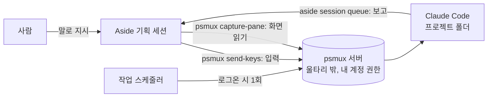

## 0. 이 문서를 쓰는 법

각 단계는 이렇게 생겼다.

> **🗣 Aside에게**
>
> Aside에게 그대로 복사해 보내는 문장

- **Aside가 하는 일:** 그 문장을 받으면 Aside가 실제로 하는 일
- **사람이 할 일:** 있을 때만 적는다
- **됐는지 보는 법:** Aside 답에서 확인할 것

> **⚠️ 확인 수준 표시**
>
> **(맥 실측)** 은 맥북에서 2026-10-24에 직접 확인한 동작으로, 윈도우도 같을 것으로 보는 것이다. **(문서)** 는 공식·프로젝트 문서에 적힌 것, **(추정)** 은 근거는 있지만 확인하지 않은 것이다. 이 방식 전체가 **3.4 연결 확인**의 성공에 달려 있다. 거기서 막히면 그 뒤는 진행하지 않는다.

### 0.1 사람이 직접 해야 하는 것은 이것뿐이다

| # | 사람이 할 일 | 왜 Aside가 못 하나 | 언제 |
|---|---|---|---|
| 1 | Aside 앱 설치·로그인 | Aside가 아직 없다 | 맨 처음 1회 |
| 2 | PowerShell에 **한 줄** 붙여넣기 (+ 설치 승인 창 클릭) | 아래 0.2 | 맨 처음 1회 |
| 3 | Aside 설정 화면에서 허용 폴더 2개 추가 | 보안 설정은 사람이 화면에서 바꾸는 게 원칙 | 맨 처음 1회 |
| 4 | 브라우저에서 Claude 로그인 승인 | 로그인은 사람이 한다 | 맨 처음 1회 |
| 5 | 윈도우 보안 창(사용자 계정 컨트롤 등)에서 「예」 | 운영체제 보안 창은 사람만 누를 수 있다 | 뜰 때마다 |
| 6 | 무엇을 만들지 결정, 결과 판단 | 기획의 주인은 사람 | 매번 |

그 밖의 설치 확인, 스크립트·설정 파일 작성, 자동 실행 등록, Claude Code 기동, 지시, 결과 확인은 **모두 Aside에게 말로 시킨다.**

### 0.2 왜 처음 한 줄만은 사람이 쳐야 하나

- Aside 에이전트의 셸은 **샌드박스(울타리) 안**에서 돈다. 윈도우판도 샌드박스가 켜져 있고 셸은 PowerShell이다(제3자 관찰, aside-skill 저장소). 맥에서는 이 울타리 때문에 Aside가 혼자서 프로그램 설치, 운영체제 자동 실행 등록, Claude Code 로그인 정보 사용을 못 했고, Aside가 직접 띄운 tmux 서버도 울타리 안이라 쓸모가 없었다(맥 실측). 윈도우도 같다고 보고(추정) 같은 구조로 간다.
- **사람이 띄운 서버(또는 작업 스케줄러가 띄운 서버)** 는 울타리 밖, 내 계정 권한으로 돈다. Aside가 거기에 붙으면 그 안의 셸로 나머지를 할 수 있다(맥 실측).
- 그래서 사람은 설치 스크립트를 **딱 한 번** 실행한다. 이 스크립트가 도구를 깔고, 작업 스케줄러에 자동 실행을 등록하고, 울타리 밖 psmux 서버를 띄운다. 이후 로그온 때마다 서버가 저절로 뜨므로 이 한 줄도 다시 칠 일이 없다.

> **⚠️ 이 구조가 뜻하는 것**
>
> psmux 서버에 붙은 Aside는 **사실상 내 윈도우 계정의 셸 전체를 쓸 수 있다**(맥 실측 기준 추정). 「말로 다 시킬 수 있다」는 편리함과 같은 크기의 권한이다. 6장의 안전 규칙을 같이 읽는다. 통로를 닫고 싶으면 3.3에서 추가한 허용 폴더를 빼면 된다.

---

## 1. 큰 그림

| 이름 | 무엇인가 | 맡는 일 |
|---|---|---|
| Aside | AI 에이전트가 들어 있는 브라우저 앱. 2026-09-14 윈도우 정식 출시 (문서) | 기획 세션. 조사·지시·검토, 그리고 이 문서의 설정 작업 |
| Aside CLI (`aside`) | 터미널에서 Aside를 부르는 명령 | Claude Code가 기획 세션에 보고하는 통로 |
| Claude Code (`claude`) | 터미널에서 도는 코딩 AI. 윈도우 10 1809+ 네이티브 지원 (문서) | 작업 담당. 코드 작성·테스트 |
| psmux | 윈도우용 tmux. tmux 명령을 그대로 알아듣는다 (문서) | Aside가 Claude Code에 입력하고 화면을 읽는 통로 |
| 작업 스케줄러 | 윈도우의 자동 실행 장치 | 로그온할 때 psmux 서버를 자동으로 띄움 |
| PowerShell 7 | 윈도우의 명령 셸 | psmux 패널 안의 기본 셸 |

> **ℹ️ 왜 tmux가 아니라 psmux인가**
>
> 윈도우용 tmux는 없다. 선택지는 ① psmux(윈도우 네이티브) ② WSL2(윈도우 안의 리눅스) 안의 진짜 tmux. Aside, Claude Code, psmux가 모두 윈도우 프로그램이면 경로와 권한이 한 세계에서 맞으므로 이 문서는 psmux를 기본으로 한다. WSL2는 7장에 대안으로 적었다.



누가 언제 움직이나 (상시 감시 프로그램은 없다):

| 단계 | 시작하는 쪽 | 일어나는 일 | 시간 |
|---|---|---|---|
| 로그온 | 작업 스케줄러 | 시작 스크립트가 psmux 서버를 띄우고 끝. 서버만 남는다 | 로그온 직후 1회 |
| Claude Code 기동 | Aside | 패널에 `cd <프로젝트>; claude` 입력 | 맥 실측 약 2초 |
| 지시 | 사람 → Aside → psmux | Claude Code가 일을 시작 | 맥 실측 짧은 답 약 3~5초 |
| 보고 | Claude Code | `aside session queue`로 기획 세션에 메시지 | 맥 실측 쉬는 세션 기준 수 초 |
| 절전·재부팅 | 윈도우 | 모두 멈춘다. psmux 서버는 창 닫기·원격 데스크톱 끊김에는 살아남지만 재부팅하면 꺼진다 (문서) | - |

psmux는 맥 tmux처럼 소켓 파일을 쓰지 않는다. 서버가 `127.0.0.1`의 임의 포트에서 기다리고, 포트 번호와 인증 키를 `%USERPROFILE%\.psmux\` 폴더의 파일에 적어 둔다. `psmux` 명령은 이 파일을 읽어 접속한다 (문서).

---

## 2. 언제 이 방식을 쓰나

| 상황 | 추천 |
|---|---|
| 한자리에서 끝나는 작은 일 | 불필요. Claude Code만 쓰고 필요할 때 `aside exec`로 Aside를 부른다 |
| 기획 맥락이 길고(며칠 조사, 로그인된 사이트 확인), 작업은 같은 PC에서 | **이 문서의 방식** |
| 작업자가 다른 컴퓨터, 잠든 동안 알림 필요 | 범위 밖. GitHub 이슈 + Actions 구성 |

지시 하나가 양쪽에서 AI 사용량을 쓴다. 맥 시험에서 Claude Code 화면의 누적 비용 표시는 첫 턴 $0.27, 몇 번 주고받은 뒤 $0.84였다(맥 실측, Claude Max 화면 표시값).

---

## 3. 처음 설정 (한 번만)

### 3.1 Aside 앱 설치 (사람)

1. https://aside.com/download 에서 윈도우용 설치 파일을 받아 실행하고 안내를 따른다.
2. Aside를 열고 로그인한다.
3. 프로젝트(예: `develop`)를 하나 만들고 그 안에서 새 대화를 연다. 이 대화를 **기획 세션**으로 쓴다. 아래 문장은 모두 이 세션에 보낸다.

### 3.2 설치 스크립트 만들기 → 사람이 한 줄 실행

> **🗣 Aside에게**
>
> 이 윈도우 PC에 Aside × Claude Code 분담 개발 환경을 처음 설치하려고 해. 내가 PowerShell에서 한 번만 실행하면 되는 설치 스크립트를 이 프로젝트 폴더에 `bootstrap-win.ps1`로 만들어줘. 윈도우 기본 PowerShell(5)에서도 돌아가야 하고, 이미 깔린 건 건너뛰어줘. 순서: winget으로 PowerShell 7, Git for Windows, psmux 설치 → 공식 설치 명령으로 Claude Code 설치 → 공식 문서의 서명 확인 방식으로 Aside CLI 설치 → `%USERPROFILE%\Develop` 폴더 생성 → psmux `dev` 세션을 그 폴더에서 분리 모드로 띄우는 시작 스크립트 `%USERPROFILE%\scripts\start-dev.ps1` 작성 → 그 스크립트를 내가 로그온할 때 내 권한으로(관리자 아님) 실행하는 작업 스케줄러 작업 `psmux-dev` 등록 → 그 작업을 지금 한 번 실행 → `psmux ls`로 확인. 단계마다 무엇을 하는지 주석을 달고, 다 만들면 내가 붙여넣을 한 줄을 알려줘.

- **Aside가 하는 일:** 프로젝트 폴더(예: `%USERPROFILE%\.aside\u\0\projects\develop\`)에 스크립트를 쓰고, 실행할 한 줄을 알려 준다. 보통 이런 모양이다.
  `powershell -ExecutionPolicy Bypass -File "$env:USERPROFILE\.aside\u\0\projects\develop\bootstrap-win.ps1"`
  스크립트 예시는 부록 A.
- **사람이 할 일:**
  1. 시작 메뉴 → 「터미널」(Windows Terminal) 또는 「PowerShell」. 프롬프트가 `PS C:\Users\이름>`처럼 `PS`로 시작하는지 확인. `PS`가 없으면 CMD이니 PowerShell을 연다.
  2. Aside가 알려 준 한 줄을 붙여넣고 Enter (붙여넣기: `Ctrl+V` 또는 마우스 오른쪽 클릭).
  3. winget이 처음이면 원본 약관 동의를 물을 수 있다(`Y`). 「이 앱이 디바이스를 변경하도록 허용하시겠어요?」 창이 뜨면 **예**.
  4. 끝에 `dev: 1 windows ...`가 나오면 창은 닫아도 된다. psmux 서버는 계속 돈다.
- **됐는지 보는 법:** 마지막 출력에 `dev:` 줄이 있다. 오류가 나면 화면을 통째로 복사해 Aside에게 붙여넣고 `이 오류 원인 찾아서 스크립트 고쳐줘`.
- `-ExecutionPolicy Bypass`는 「이 스크립트 한 번만 실행 정책 검사를 건너뛴다」는 뜻이다. 컴퓨터 설정은 바뀌지 않는다.

### 3.3 Aside에 psmux 사용 허락 (사람, 설정 화면)

> **🗣 Aside에게 (안내만 받을 때)**
>
> psmux를 쓰려면 Settings에서 어떤 폴더를 허용해야 하는지 알려줘. psmux 실행 파일의 실제 위치를 찾아서 정확한 경로로 알려주고, 메뉴 위치도 한 단계씩 알려줘.

- **Aside가 하는 일:** 자기 셸에서 `(Get-Command psmux).Source`를 시도해 위치를 알려 준다. 울타리 때문에 못 찾으면 「사람이 PowerShell에서 이 명령을 쳐서 결과를 알려달라」고 한다.
- **사람이 할 일:** Aside **Settings** → **Agent** 그룹 → **Agents** → **File permissions** → **Can view** 옆 **Add** 로 두 폴더를 추가(추정, 맥에서 `/opt/homebrew`를 넣었던 것에 대응).

| 허용할 폴더 | 이유 |
|---|---|
| psmux 실행 파일이 있는 폴더 | 실행하려면 읽기 권한 필요 |
| `%USERPROFILE%\.psmux` | psmux 서버의 포트·인증 키 파일. 숨김 폴더일 수 있으니 폴더 선택 창 주소창에 경로를 직접 입력 |

- 같은 화면의 **Sandbox** 끄기 스위치는 건드리지 않는다. 모든 제한을 푸는 스위치다.
- `.psmux` 폴더의 키 파일은 내 psmux 서버에 접속하는 열쇠다. psmux는 이 파일을 내 사용자 프로필만 읽을 수 있게 두는 것을 접근 제어로 삼는다 (문서). 이 폴더를 OneDrive 등 동기화 폴더로 옮기거나 공유하지 않는다.

### 3.4 연결 확인 (가장 중요)

이 방식에서 **확인되지 않은 가장 큰 고리**가 「윈도우판 Aside가 psmux 서버에 붙을 수 있는가」다.

> **🗣 Aside에게**
>
> psmux 서버에 붙어서 세션·패널 목록을 보여줘. 각 패널의 패널 ID, 실행 중인 명령, 보기 모드 여부, 현재 폴더까지. 붙은 서버가 작업 스케줄러가 띄운(샌드박스 밖) 서버인지도 확인해줘. 서버가 없으면 새로 띄우지 말고 알려줘. 실패하면 오류 문구를 그대로 보여주고 원인 후보를 알려줘.

- **Aside가 하는 일:** `psmux list-panes -a -F '#{session_name} #{pane_id} #{pane_current_command} #{pane_in_mode} #{pane_current_path}'` 실행.
- **됐는지 보는 법:** `dev %0 pwsh 0 C:\Users\<나>\Develop` 같은 줄.
- **실패할 때:**

| Aside가 보여 준 결과 | 원인 후보 | 다음 |
|---|---|---|
| `blocked by policy`, 접근 거부 | 3.3 허용 폴더 문제 | 경로 다시 확인 후 재시도 |
| 아무 응답 없이 멈춤 | 윈도우판 Aside 셸 도구 문제. 제3자 조사(Aside 1.26.906)에서 CLI를 Guard 모드로 실행할 때 셸 도구가 응답 없이 멈춘 사례가 있다 | Aside 업데이트 후 재시험. 앱 대화에서도 같은지는 모른다 |
| 접속 거부, 시간 초과 | 샌드박스가 `127.0.0.1` 접속을 막을 가능성 (미확인) | 7장 WSL 대안도 같은 벽에 부딪힐 수 있다 |
| 「서버 없음」 | 3.2 마지막 단계 실패 | 작업 스케줄러 `psmux-dev`의 마지막 실행 결과를 확인해줘 |

여기서 막히면 **멈추고 결과를 기록해 둔다(8장의 미확인 항목).** 이후 단계는 연결이 될 때만 의미가 있다.

이 시점부터 Aside는 울타리 밖 셸을 쓸 수 있다. 이후 설정은 전부 이 통로로 한다.

### 3.5 Claude Code 첫 실행과 로그인

> **🗣 Aside에게**
>
> psmux `dev`의 `%0` 패널이 pwsh 상태인지 확인하고, `%USERPROFILE%\Develop\<프로젝트>` 폴더를 만들어서 그 안에서 Claude Code를 띄워줘. 로그인이 필요하다고 나오면 화면 내용을 알려주고 내가 로그인할 때까지 기다려줘.

- **Aside가 하는 일:** 패널 상태 확인 → `New-Item -ItemType Directory -Force ...; cd ...; claude` 입력 → 화면을 읽어 로그인 안내를 전달.
- **사람이 할 일:** 브라우저에 Claude 로그인 창이 뜨면 로그인하고 승인. **Pro, Max, Team, Enterprise 요금제나 Console 계정**이 필요하다(무료 요금제 불가). 첫 실행 질문(테마 등)은 `기본값으로 진행해줘`.
- **됐는지 보는 법:** Aside가 「Claude Code 시작 화면이 보인다」고 보고. 패널 실행 명령이 `pwsh`에서 `claude`로 바뀐다(psmux는 맨 앞 프로세스 이름을 보여준다, 문서).
- Claude Code가 「Git Bash를 찾을 수 없다」고 하면: `` Claude Code 설정 파일에 Git Bash 경로(`CLAUDE_CODE_GIT_BASH_PATH`)를 넣어줘 ``(문서).

### 3.6 핑 시험 (기획 → 작업)

> **🗣 Aside에게**
>
> `%0`의 Claude Code에 『도구 쓰지 말고 pong 한 단어로만 답해줘』를 보내고 답을 읽어줘.

- **됐는지 보는 법:** 몇 초 뒤 `pong`.

### 3.7 자동 실행 확인

자동 실행은 3.2의 스크립트가 이미 등록했다.

> **🗣 Aside에게**
>
> 작업 스케줄러 `psmux-dev` 작업의 설정(트리거, 실행 계정, 실행 프로그램, 마지막 실행 결과)을 보여주고, 로그온할 때 내 권한으로 `start-dev.ps1`을 실행하도록 맞게 되어 있는지 점검해줘.

- **됐는지 보는 법:** 트리거가 「로그온할 때」, 계정이 내 계정, 실행 수준이 관리자 아님, 마지막 실행 결과(`LastTaskResult`)가 `0`.
- **마지막 확인(사람, 선택):** 한 번 로그아웃 후 로그인하고 Aside에게 `psmux 세션 목록 보여줘`. `dev`가 있으면 끝.

> **ℹ️ 참고: 작업 스케줄러 작업이 갖춰야 할 것과 이유 (Aside 결과물 검토용)**
>
> | 항목 | 이유 |
> |---|---|
> | 트리거: 로그온할 때(`-AtLogOn`), 내 계정 | 맥 LaunchAgent의 「로그인 때 1회」에 대응 |
> | 로그온 유형: 대화형(`Interactive`) | 로그온한 내 세션 안에서 실행. Claude Code 로그인 정보·설정을 그대로 씀 |
> | 실행 수준: 제한(`Limited`) | 관리자 권한 없이 실행 |
> | 실행: `pwsh.exe -NoProfile -WindowStyle Hidden -File %USERPROFILE%\scripts\start-dev.ps1` | 창 숨김. 실행 순간 창이 잠깐 깜빡일 수 있다 |
> | 시작 스크립트: `psmux has-session -t dev` 실패 시에만 `psmux new-session -d -s dev -c %USERPROFILE%\Develop` | 중복 방지. `-d`는 화면 없이 띄우기 |
> | 배터리 상태에서도 실행 | 노트북용 |
>
> psmux 문서 예시는 로그인 전 부팅 시 실행용이라 `-AtStartup` + `S4U`를 쓴다. 이 문서는 로그인한 사람의 환경이 필요하므로 `-AtLogOn` + `Interactive`로 바꿨다(추정에 근거한 선택). psmux 서버는 창 없이 분리돼 작업 스케줄러로 띄운 뒤에도 살아남도록 만들어져 있다 (문서).

### 3.8 프로젝트 규칙 넣기 (양쪽)

> **🗣 Aside에게 (Aside 쪽 규칙)**
>
> 이 프로젝트 메모리(MEMORY.md)에 『로컬 Claude Code 운영 규칙(윈도우)』을 추가해줘. 내용: 셸은 PowerShell이니 bash 문법 쓰지 않기, psmux 실행 파일 경로와 `.psmux` 위치 기록, psmux 서버는 직접 띄우지 말고 작업 스케줄러(또는 내)가 띄운 서버에만 붙기, 대상은 패널 ID로만 지정, 보내기 전에 pwsh인지 claude인지와 보기 모드 여부 확인, 텍스트와 Enter는 따로 전송, 따옴표가 겹치는 명령은 `.ps1` 파일로 만들어 `pwsh -File`로 실행, Claude Code는 항상 프로젝트 폴더를 명시해 실행하고 불분명하면 나에게 묻기, Claude Code의 권한 확인 질문에는 답하지 말고 나에게 넘기기, PowerShell 프로필·키·토큰 파일·`.psmux` 폴더는 psmux 통로로 건드리지 않기(내가 명시적으로 시킬 때만 예외), 결과는 Claude Code가 입력 대기 상태가 된 뒤 다시 읽고 판단.

> **🗣 Aside에게 (Claude Code 쪽 규칙)**
>
> `%USERPROFILE%\Develop\<프로젝트>\CLAUDE.md`에 『기획 세션에 보고하기』 규칙을 추가해줘. 보고 대상은 **지금 이 세션의 ID와 계정**으로 채워줘(계정은 기본 계정이면 `u0`, 아니면 실제 계정으로). 내용: 작업을 끝냈거나 결정이 필요해 멈출 때 `aside session queue --account u0 <세션ID> '[dev] <완료|질문|실패> <한 줄 요약>. 자세한 내용: <파일 경로>'`로 한 번 보고, 메시지는 작은따옴표로 감싸고 안에 작은따옴표가 필요하면 두 번 쓰기, 긴 내용은 `docs\handoff\` 아래 파일로 쓰고 경로만 보내기, steer는 쓰지 않기, 보고 뒤에는 다음 지시를 기다리기. 기존 CLAUDE.md가 있으면 내용을 먼저 보여주고 끝에 덧붙여줘. 그리고 이 프로젝트 폴더를 네가 읽을 수 있는지 확인해서, 안 되면 허용 폴더에 무엇을 추가해야 하는지 알려줘.

- **Aside가 하는 일:** 자기 세션 ID를 알고 있으므로 직접 채워 넣는다. CLAUDE.md는 psmux 통로로 쓴다.
- **사람이 할 일:** Aside가 「보고서 파일을 읽으려면 `%USERPROFILE%\Develop`을 Can view에 추가해야 한다」고 하면 3.3과 같은 방법으로 추가.
- `[dev]` 접두어는 「사람이 친 메시지」와 「Claude Code가 보낸 메시지」를 구분하는 유일한 표시다. Aside 기록에는 둘을 구분하는 칸이 없다(2026-10-21 확인). **관례**일 뿐이다.
- **문서 폴더 주의:** 윈도우의 「문서」 폴더는 OneDrive로 옮겨져 있는 경우가 많다(예: `C:\Users\<나>\OneDrive\문서`). 프로젝트는 OneDrive 밖(`%USERPROFILE%\Develop`)에 두는 편이 동기화 충돌이 없다. 경로가 헷갈리면 `내 문서 폴더의 실제 경로 확인해줘`.

### 3.9 왕복 시험 (작업 → 기획)

> **🗣 Aside에게**
>
> `%0`의 Claude Code에게, CLAUDE.md의 보고 규칙대로 너에게 `[dev 테스트] pong` 한 줄을 queue로 보내라고 시켜줘. 메시지가 너한테 도착하면 알려줘.

- **됐는지 보는 법:** Claude Code 화면에 `ok  idle`(또는 `ok  running`)이 찍히고, 기획 세션에 `[dev 테스트] pong`이 사용자 턴으로 들어온다. 맥에서는 이렇게 동작했고(맥 실측), Aside CLI는 윈도우에서도 같은 명령이다 (문서).
- `Aside isn't running on this machine`이 나오면 Aside 앱이 꺼져 있는 것이다. session 명령은 Aside 앱이 도는 그 PC에서만 된다.

### 3.10 (선택) 사용자 폴더(홈)에서 Claude Code가 뜨지 않게 막기

Claude Code는 실행한 폴더를 작업 범위로 잡는다. `C:\Users\<나>`에서 뜨면 `.ssh`, `.aside`, `.claude`, 토큰 파일까지 범위에 들어가고 auto mode면 묻지 않고 읽거나 고칠 수 있다.

> **🗣 Aside에게**
>
> PowerShell 프로필(`$PROFILE`)에 현재 폴더가 사용자 폴더일 때는 `claude` 실행을 거부하는 함수를 추가해줘. 프로필이 없으면 만들고, 있으면 먼저 백업해줘. 추가할 내용을 먼저 보여주고 내가 승인하면 넣어줘. 넣은 다음 새 패널을 열어서 사용자 폴더에서 `claude`가 거부되는지 시험하고 패널은 닫아줘. 프로필이 실행 정책 때문에 안 읽히면 이유와 해결 방법을 알려줘.

- 셸 설정 파일을 psmux 통로로 고치는 일이라 3.8 규칙의 **명시적 예외**다. 그래서 `승인하면 넣어줘`를 붙였다.
- 한계: `claude.exe`처럼 확장자를 붙이거나 전체 경로로 우회할 수 있다. 실수 방지용이다.
- 프로필이 실행 정책 때문에 안 읽히면 `Set-ExecutionPolicy -Scope CurrentUser RemoteSigned`가 필요할 수 있다. 내 계정에만 적용되는 설정 변경이므로 Aside가 실행 전에 물어보게 한다.

---

## 4. 매일 쓰는 방법

### 4.1 자주 쓰는 말

| 하고 싶은 일 | 🗣 Aside에게 |
|---|---|
| 상태 보기 | psmux 패널 목록과 각 패널에서 뭐가 돌고 있는지 보여줘 |
| 작업 넘기기 | 방금 정리한 기획안을 `<프로젝트>` Claude Code에 넘겨줘. 패널이 없으면 좌우로 나눠서 `Develop\<프로젝트>`에서 새로 띄워줘 |
| 이전 대화 이어서 | `<프로젝트>` 패널에서 Claude Code를 `--continue`로 다시 띄워줘 |
| 진행 확인 | `<프로젝트>` 패널 화면 마지막 100줄 읽고 지금 어디까지 했는지 요약해줘 |
| 추가 지시 | `<프로젝트>` Claude Code에 『…』라고 전해줘 |
| 죽은 Claude Code 살리기 | `<프로젝트>` 패널을 claude로 다시 시작해줘 (psmux `respawn-pane`) |
| 결과 검토 | Claude Code가 보낸 보고서 파일 읽고 기획 의도와 다른 점을 짚어줘 |
| 패널 정리 | `<프로젝트>` Claude Code를 /exit로 끄고 패널을 닫아줘 |
| 하루 마무리 | 모든 패널의 Claude Code를 /exit로 끄고 dev 세션만 남겨줘 |

- 「수평 분할」은 사람마다 뜻이 달라 「좌우」/「위아래」로 말하는 게 확실하다. `-h`가 좌우다.
- 위 동작은 모두 psmux 문서에 있는 tmux 호환 명령으로 한다. 윈도우에서 직접 해 본 것은 없다.

### 4.2 보고는 어떻게 들어오나 (queue와 steer)

| | 기획 세션이 쉬는 중 | 기획 세션이 일하는 중 |
|---|---|---|
| `queue` (보고용) | 바로 처리 | 지금 일이 끝난 뒤 순서대로. 앞 일 유지, 유실 없음 (맥 실측) |
| `steer` (긴급 정정용) | queue와 같음 | 지금 단계 뒤에 끼어듦. **앞 일은 버려짐** (맥 실측) |

- 바쁜 세션에 queue가 들어오면 「메시지 본문이 비어 있습니다」 같은 답이 하나 더 붙는 경우가 있었다(3건 중 2건, 맥 실측). 무시해도 된다.
- 상대 기록을 읽는 건 그 순간의 스냅샷이다. `Claude Code가 입력 대기 상태가 되면 다시 확인해줘`라고 시킨다.

---

## 5. 재부팅 후, 또는 문제가 생겼을 때

### 5.1 점검은 한 문장으로

> **🗣 Aside에게**
>
> 분담 개발 환경 점검해줘: psmux 서버와 dev 세션이 있는지, 작업 스케줄러 `psmux-dev`의 마지막 실행 결과, 각 패널의 실행 명령과 폴더, 보기 모드에 걸린 패널이 있는지. 문제가 있으면 원인과 고칠 방법을 알려줘.

### 5.2 증상별

| 증상 | 원인 (추정 포함) | 🗣 Aside에게 / 사람이 할 일 |
|---|---|---|
| Aside: `blocked by policy` / 접근 거부 | 허용 폴더 누락 | 사람: 3.3 |
| Aside: 셸 명령이 응답 없이 멈춤 | 윈도우판 Aside 셸 도구 문제 가능성 (제3자 관찰) | 사람: Aside 업데이트 후 재시험 |
| 세션 없음 | 재부팅 뒤 작업이 안 돌았거나 서버가 죽음. Aside는 울타리 밖 서버를 스스로 못 띄운다 (추정) | 사람: PowerShell에서 `Start-ScheduledTask -TaskName psmux-dev` 한 줄. 이후 `작업이 왜 안 돌았는지 확인해줘` |
| 보낸 글자가 사라짐 | 패널이 보기 모드(`pane_in_mode=1`) | 보기 모드 해제하고 다시 보내줘 |
| 대상 패널을 못 찾음 | 창·패널 번호가 생각과 다름 | 패널 ID로 다시 지정해줘 |
| 지시문이 셸 명령으로 실행됨 | Claude Code가 꺼진 패널에 보냄 | 방금 셸에서 실행된 게 뭔지 확인하고, 해가 없는지 알려줘 |
| 따옴표가 섞인 명령이 깨짐 | PowerShell 문자열 안의 따옴표 중첩 | `.ps1` 파일로 만들어서 실행해줘 |
| 새 패널이 엉뚱한 폴더 | 명령을 보낸 쪽 작업 폴더를 따라감 (맥에서 관찰) | `-c`로 폴더를 지정해서 다시 열어줘 |
| `&&`가 오류 | PowerShell 5에서 실행됨 | 패널 셸이 PowerShell 7인지 확인해줘 |
| 로그온 때 파란 창이 잠깐 깜빡임 | 숨김 실행도 시작 순간은 창이 뜬다 | 정상 |
| Claude Code가 로그인 안 된 상태로 뜸 | Aside가 직접 띄운 서버(울타리 안)에서 실행됐을 가능성 | 지금 붙은 psmux 서버가 작업 스케줄러가 띄운 것인지 확인해줘 |
| `aside session queue`: Aside isn't running | Aside 앱이 꺼짐 | 사람: Aside 실행 |
| 경로에 `Documents`가 없다고 나옴 | 문서 폴더가 OneDrive로 옮겨짐 | 문서 폴더의 실제 경로 확인해서 다시 해줘 |

---

## 6. 안전 규칙: 강제되는 것과 약속뿐인 것

| 규칙 | 무엇이 막나 | 강제 여부 |
|---|---|---|
| Aside 자기 셸은 허용 폴더 밖을 못 건드린다 | Aside 샌드박스 | **강제**. 단 psmux 통로로 우회됨 (추정) |
| psmux 패널에 보낸 명령은 내 계정 권한으로 실행 | 없음 | 막는 장치 없음. 통로를 닫으려면 3.3의 허용 폴더 제거 |
| 다른 사용자가 내 psmux 서버에 접속 | `.psmux` 키 파일 (접속 시 키 요구) | **강제**. 단 키 파일을 읽을 수 있으면 누구든 접속 가능 (문서) |
| 사용자 폴더에서 claude 실행 금지 | PowerShell 프로필 함수 (3.10) | 넣으면 **강제**(우회 가능), 없으면 관례 |
| Claude Code 권한 확인에 Aside가 답하지 않음 | 3.8 규칙 | **관례**. `send-keys`는 사람이 친 것과 구별되지 않는다 |
| 셸 설정·키 파일은 명시적으로 시킬 때만 | 3.8 규칙 | **관례** |
| 보고는 queue, `[dev]` 접두어 | CLAUDE.md 규칙 | **관례** |
| 기획이 결과를 받고 다음 지시를 자동으로 내리지 않음 | 사람이 다음 지시를 준다 | **관례**. 깨지면 기획 → 작업 → 보고 → 기획이 끝없이 돈다 |

- 이 방식에서는 **사람이 Aside에게 하는 말이 곧 셸 명령**이 된다. 「삭제」, 「초기화」, 「전부」가 들어간 지시는 `실행 전에 대상 목록부터 보여줘`를 붙인다.
- 네이티브 윈도우의 Claude Code는 명령 격리(샌드박스) 기능을 지원하지 않는다. WSL2에서만 지원한다 (문서). 그래서 auto mode의 위험이 맥보다 크다. 처음 몇 번은 기본 모드(실행 전에 묻는 모드)로 써 본다.
- 다른 컴퓨터나 믿을 수 없는 곳에서 온 결과는 사람이 먼저 보고 넣는다.

---

## 7. 대안: WSL2 + 진짜 tmux

리눅스 도구로 개발하거나 Claude Code의 샌드박스 기능이 필요할 때의 대안이다. **psmux보다 단계가 많고 Aside와의 연결은 더 불확실하다.**

> **🗣 Aside에게**
>
> WSL2로 분담 개발 환경을 만들고 싶어. 내가 관리자 PowerShell에서 실행할 설치 스크립트를 만들어줘: `wsl --install`(재부팅이 필요하면 알려주기), 재부팅 후 Ubuntu 안에 tmux와 Claude Code 설치, `~/Develop`에서 tmux `dev` 세션을 띄우는 시작 스크립트, `%USERPROFILE%\.wslconfig`에 WSL이 저절로 꺼지지 않게 하는 설정, 로그온할 때 그 시작 스크립트를 `wsl.exe`로 실행하는 작업 스케줄러 작업. 단계마다 내가 해야 하는 일(재부팅, Ubuntu 사용자 만들기)을 구분해서 알려줘.

- **사람이 할 일:** 관리자 PowerShell에서 실행, 재부팅, 처음 Ubuntu를 열 때 리눅스 사용자 이름·비밀번호 만들기.
- 알아 둘 점:
  - WSL은 연결된 창이 모두 닫히면 잠시 뒤 스스로 꺼지고, 안의 tmux도 같이 사라질 수 있다. `.wslconfig`의 `[wsl2]` 아래 `vmIdleTimeout`(기본 60000ms)과 `instanceIdleTimeout`(기본 15000ms, `-1`이면 자동 종료 안 함)로 조절하고, 바꾼 뒤 `wsl --shutdown`으로 완전히 껐다 켜야 적용된다 (문서).
  - Aside가 WSL 안 tmux를 조작하려면 매번 `wsl.exe -d Ubuntu -- tmux ...`를 거쳐야 한다. Aside 샌드박스가 `wsl.exe`를 허용하는지 모른다.
  - WSL 안의 Claude Code가 윈도우의 `aside` CLI(`aside.exe`)를 불러 보고할 수 있는지 모른다.
  - 둘 중 하나라도 안 되면 「기획 → 작업」이나 「작업 → 기획」 한쪽이 끊긴다. 먼저 3.4와 같은 연결 확인부터 한다: `` `wsl.exe -d Ubuntu -- tmux ls` 실행해줘 ``.

---

## 8. 아직 확인하지 않은 것

- **가장 중요:** 윈도우판 Aside가 psmux 명령을 실행하고 `127.0.0.1` 서버에 붙을 수 있는지 (3.4).
- Aside가 직접 psmux 서버를 띄웠을 때 맥처럼 울타리 안에서 도는지.
- 3.2 설치 스크립트를 실제 윈도우에서 돌린 적은 없다. winget 패키지 이름(`psmux`), Claude Code 설치 후 PATH 반영 시점이 특히 확인 대상이다.
- 작업 스케줄러 `-AtLogOn` + `Interactive` 구성으로 로그온 때 `dev` 세션이 실제로 생기는지.
- psmux의 창 번호 시작값, PowerShell 프로필 함수가 psmux 패널에서도 적용되는지.
- `claude --continue`로 띄웠을 때 직전 대화가 이어지는지.
- 같은 PC에서 Aside 앱이 로그인돼 있으면 CLI 로그인이 따로 필요 없는지(맥에서는 따로 필요 없었다).
- WSL2 방식(7장) 전체.

---

## 부록 A. 설치 스크립트 예시 (3.2에서 Aside가 만드는 것)

검토용이다. Aside가 만든 스크립트가 대략 이 일을 하는지 보면 된다. **윈도우에서 실행해 본 적은 없다.**

```powershell
# bootstrap-win.ps1 : Aside × Claude Code 분담 개발 환경 첫 설치 (이미 있는 것은 건너뜀)
# 실행: powershell -ExecutionPolicy Bypass -File <이 파일 경로>
$ErrorActionPreference = 'Stop'
function Has($name) { [bool](Get-Command $name -ErrorAction SilentlyContinue) }
function Refresh-Path {   # 방금 설치한 프로그램이 이 창에서도 잡히게
  $env:Path = [Environment]::GetEnvironmentVariable('Path','Machine') + ';' +
              [Environment]::GetEnvironmentVariable('Path','User') + ';' +
              "$env:USERPROFILE\.local\bin"
}
$wg = '--exact','--accept-source-agreements','--accept-package-agreements'

# 1) PowerShell 7, Git for Windows (Claude Code가 Git Bash를 씀), psmux (윈도우용 tmux)
if (-not (Has pwsh))  { winget install --id Microsoft.PowerShell @wg }
if (-not (Has git))   { winget install --id Git.Git @wg }
if (-not (Has psmux)) { winget install psmux --accept-source-agreements --accept-package-agreements }
Refresh-Path

# 2) Claude Code (공식 설치 명령, 자동 업데이트됨)
if (-not (Has claude)) { Invoke-RestMethod https://claude.ai/install.ps1 | Invoke-Expression }
Refresh-Path

# 3) Aside CLI (공식 문서 방식: 서명이 Aside 회사 것인지 확인한 뒤에만 실행)
if (-not (Has aside)) {
  $installer = Join-Path $env:TEMP 'aside-install.ps1'
  $publisher = 'CN=AT YOUR SIDE INC, O=AT YOUR SIDE INC, L=San Francisco, S=California, C=US'
  Invoke-WebRequest -UseBasicParsing -Uri https://releases.aside.com/install.ps1 -OutFile $installer
  $sig = Get-AuthenticodeSignature -LiteralPath $installer
  if ($sig.Status -ne 'Valid' -or $sig.SignerCertificate.Subject -ne $publisher -or $null -eq $sig.TimeStamperCertificate) {
    throw "Aside CLI 설치 파일 서명 확인 실패 ($($sig.Status))"
  }
  & $installer
  Refresh-Path
}

# 4) 작업 폴더와 psmux 시작 스크립트
New-Item -ItemType Directory -Force "$env:USERPROFILE\Develop", "$env:USERPROFILE\scripts" | Out-Null
@'
psmux has-session -t dev 2>$null
if ($LASTEXITCODE -ne 0) { psmux new-session -d -s dev -c "$env:USERPROFILE\Develop" }
'@ | Set-Content -Encoding UTF8 "$env:USERPROFILE\scripts\start-dev.ps1"

# 5) 로그온할 때 내 권한으로 시작 스크립트 실행 (관리자 아님)
if (-not (Get-ScheduledTask -TaskName 'psmux-dev' -ErrorAction SilentlyContinue)) {
  $me = "$env:USERDOMAIN\$env:USERNAME"
  $action    = New-ScheduledTaskAction -Execute 'pwsh.exe' `
               -Argument "-NoProfile -WindowStyle Hidden -File `"$env:USERPROFILE\scripts\start-dev.ps1`""
  $trigger   = New-ScheduledTaskTrigger -AtLogOn -User $me
  $principal = New-ScheduledTaskPrincipal -UserId $me -LogonType Interactive -RunLevel Limited
  $settings  = New-ScheduledTaskSettingsSet -AllowStartIfOnBatteries -DontStopIfGoingOnBatteries
  Register-ScheduledTask -TaskName 'psmux-dev' -Action $action -Trigger $trigger -Principal $principal -Settings $settings | Out-Null
}

# 6) 지금 한 번 실행하고 확인 (작업 스케줄러가 띄운 서버 = 울타리 밖)
Start-ScheduledTask -TaskName 'psmux-dev'
Start-Sleep -Seconds 3
psmux -V; claude --version; aside --version; psmux ls
```

- 서버를 스크립트 안에서 직접 띄우지 않고 작업 스케줄러로 띄우는 이유: 평소 로그온 때와 똑같은 경로로 띄워야, 자동 실행이 제대로 되는지 이 자리에서 바로 확인되기 때문이다.
- 작업 등록이 「액세스 거부」로 실패하면 관리자 PowerShell에서 다시 실행한다.
- 회사 관리 PC에서 Aside CLI 서명 확인이 `UnknownError`로 실패하면 관리자에게 `Microsoft Identity Verification Root Certificate Authority 2020` 인증서 추가를 요청한다 (문서).
- Claude Code를 `winget install Anthropic.ClaudeCode`로 까는 방법도 있지만 자동 업데이트가 안 된다. 공식 설치 명령은 자동 업데이트된다 (문서).
- GitHub CLI는 GitHub 이슈를 주고받는 단계로 갈 때만 필요하다. 그때 `gh 설치하고 로그인 준비해줘`라고 시키고, 로그인 승인은 사람이 한다.

## 부록 B. 출처

- Claude Code 설치·윈도우 설정(네이티브 / WSL, Git Bash, 샌드박스 지원 여부): https://code.claude.com/docs/en/setup (2026-10-24 확인)
- Aside CLI 설치(윈도우 PowerShell)·로그인·계정: https://docs.aside.com/help/developers
- Aside 에이전트 권한(Sandbox, File permissions): https://docs.aside.com/help/security
- Aside 다운로드: https://aside.com/download · 윈도우 정식 출시(2026-09-14): https://docs.aside.com/changelog/native
- psmux: https://github.com/psmux/psmux · 구조(TCP + `.psmux` 키 파일): `docs/architecture.md` · 활용(작업 스케줄러 예시): `docs/use-cases.md` · AI 에이전트 운용: `docs/tutorials/terminal-agents-and-tuis.md`
- WSL 설정(`vmIdleTimeout`, `instanceIdleTimeout`): https://learn.microsoft.com/en-us/windows/wsl/wsl-config
- 윈도우판 Aside 셸·샌드박스 관찰(제3자): https://github.com/lidge-jun/aside-skill (`aside-jun/references/permissions.md`)
- 맥 실측 근거: [맥 사용자용 가이드](/dev/2026/10/24/aside-기획-claude-code-작업-분담-개발-가이드-맥/), 2026-10-24 맥북 연동 실험 기록(비공개)
